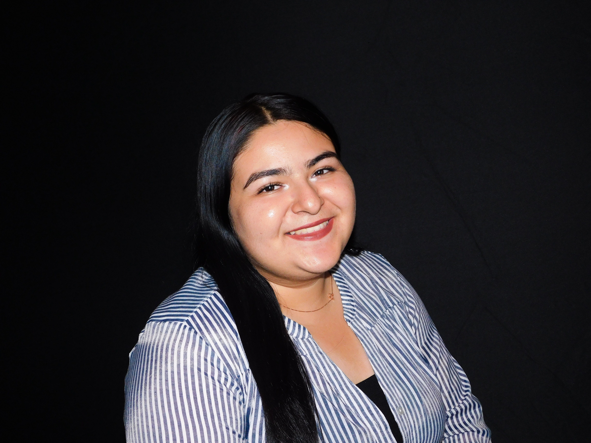

## About Me

{width="220px" style="border-radius: 12px;" fig-align="center"}

I am a graduate student pursuing a **Master of Science in Digital Marketing (MSDM)** at **Cal Poly Pomona**, building on a bachelor's degree in **Spanish** from **Cal State San Marcos**. I focus on turning marketing research, survey data, and digital analytics into clear, actionable decisions.

## Career Aspirations

I aim to work in digital marketing analytics, consumer insights, or marketing operations bringing a passion for community empowerment, inclusive marketing, and building meaningful connections with diverse audiences.

## Core Skills

- **Analytics & Programming:** R (`tidyverse`, `readr`, `dplyr`, `tidyr`, `gt`), SQL, Google BigQuery, Google Analytics 4 (GA4)
- **Survey & Research Methods:** Qualtrics survey design, reliability/factor analysis, CFA/SEM workflows, Case 31 data preparation
- **Publishing & Reproducibility:** Quarto (`.qmd`, Revealjs, websites), RStudio, Git & GitHub, Zotero

## Education

- **M.S. in Digital Marketing (MSDM)** — California State Polytechnic University, Pomona (Cal Poly Pomona)
- **B.A. in Spanish** — California State University, San Marcos (Cal State San Marcos)
